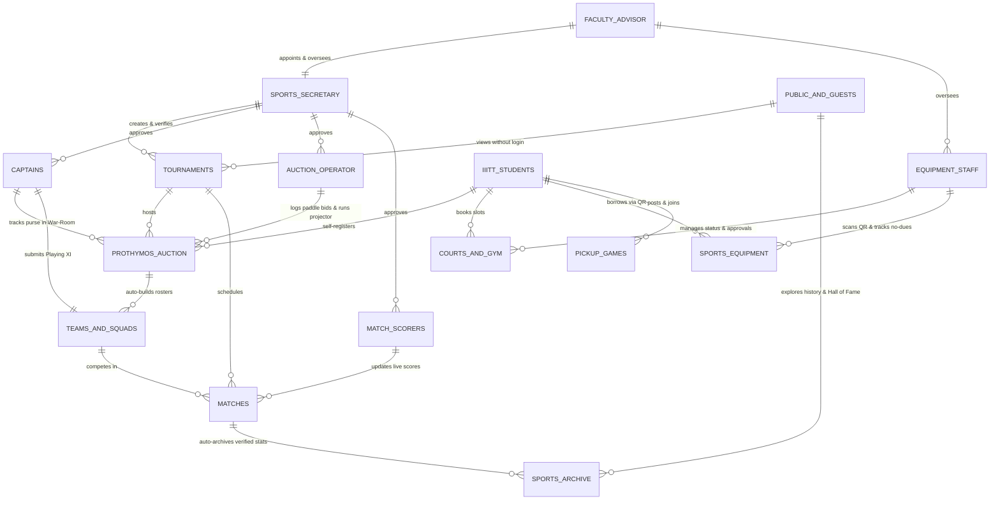

# IIITT Sports App — Master Product Requirements Document (PRD)
# THIS IS DISCONTINUED AND THE NEXT VERSION HAS A LOT OF INCLUDED FEATURES IN IT

**Product:** IIITT Sports App

**Institution:** Indian Institute of Information Technology Tiruchirappalli (IIITT)

**Version:** 1.1 — Final Consolidated Specification

**Vision:** A unified digital sports management platform for IIITT, connecting everyday campus sports, tournaments, player management, stage-driven Prothymos auctions, and the institute's permanent sports history.

---

## 1. Product Vision & Core Principle

The IIITT Sports App serves as the single source of truth for all sports activities at IIITT—connecting casual students, competitive athletes, team captains, tournament organizers, ground staff, faculty, and public spectators.

**Defining Principle — Vertical Integration:**

> **Student Registration → Prothymos Auction → Franchise Roster → Playing XI → Live Match Scoring → Player Statistics → Permanent Sports Archive**

All modules share the same underlying data rather than operating as disconnected forms or spreadsheets.

**Primary Objectives:**

1. Simplify everyday access to campus sports facilities and gym capacity.
2. Digitize sports equipment issuing, tracking, and semester no-dues clearance.
3. Enable transparent tournament organization and live multi-sport scoring.
4. Power **Prothymos** with an IPL-style, stage-driven multi-sport auction engine.
5. Maintain official player statistics, leaderboards, and achievements.
6. Preserve historical tournaments in a permanent, searchable **Sports Archive**.
7. Provide open, login-free visibility for alumni, parents, and public spectators.

---

## 2. User Roles & Authority Hierarchy

| User Role | Account Type | Granted By | Core Responsibilities & Permissions |
| --- | --- | --- | --- |
| **Super Admin / System Owner** | Platform Tech Account | System Provisioned | Technical configuration, account recovery, security, database & infrastructure administration. *(Does not hold institute sports authority.)* |
| **Faculty Advisor / PED** | Separate Faculty Account | Super Admin | Highest sports authority; appoints/hands over Sports Secretary role, approves Inter-IIIT contingents, reviews audit logs & official records. |
| **Sports Secretary** | `@iiitt.ac.in` (Admin) | Faculty Advisor | Creates tournaments & auctions, configures facility rules, assigns/revokes event roles, verifies match results, publishes official notices, manages archive. |
| **Equipment & Ground Staff** | Separate Staff Account | Faculty Advisor | Scans student QR IDs, issues/returns equipment, updates inventory/condition, manages facility check-ins, marks grounds open/closed for maintenance or rain. |
| **Event Officials** *(Captain, Auction Operator, Match Scorer, Tournament Manager)* | `@iiitt.ac.in` (Event-Scoped) | Sports Secretary | Scoped strictly to assigned tournaments/auctions: manage team lineups & war-room (Captain), run live auction console (Operator), record live scores (Scorer), manage fixtures (Manager). |
| **Students / Players** | `@iiitt.ac.in` (Auto) | Self-Service (No approval) | Book facilities, borrow gear via QR, post/join pickup games, freely register for Prothymos auctions & trials, view profiles and live scores. |
| **Public / Guests** | No Login Required | Open Access | Read-only access to live scores, tournament fixtures, points tables, auction results, public player profiles, Sports Archive, Hall of Fame, and official announcements. |

**Security Rule:** Event roles are always scoped to a specific tournament or auction. A student can be Captain in Volleyball 2026, Match Scorer in Cricket 2026, and a regular student everywhere else.

---

## 3. Authentication & Frictionless Onboarding

* **Authentication:** Google OAuth strictly restricted to `@iiitt.ac.in` for students (automatic account creation). Separate login provisioning for Faculty Advisor and Equipment/Ground Staff.
* **Quick Onboarding (No Sports Questions):** Collect only:
* Name (auto-filled from institute email)
* Roll number (if available)
* Batch / Year
* Hostel *(optional)*
* Profile picture *(optional)*

* **Instant Access:** Students land directly on the Home Dashboard with an auto-generated **Student QR ID** for equipment borrowing. Sports preferences, positions, and skill levels can be added optionally anytime via **Edit Sports Profile**.

---

## 4. Campus Sports & Facilities

### 4.1 Facility Directory

Covers Cricket Ground, Football Ground, Volleyball Court, Badminton Court, Basketball Court, Table Tennis, Gym, and other campus venues. Each displays location, timings, rules, capacity, available slots, and live status:
`Open | Occupied | Closed | Maintenance | Weather Closure`

### 4.2 Configurable Booking Modes

Each facility's booking mode is configurable by the Sports Secretary:

* **Direct Booking:** Instant confirmation *(recommended for everyday Badminton & Table Tennis)*.
* **Approval Required:** Student requests a slot; staff approves or rejects *(recommended for Cricket/Football grounds and team practice)*.
* **Staff Managed:** Only authorized staff create reservations *(official training blocks & institute events)*.
* **Capacity Based:** Students reserve access within a maximum headcount limit *(recommended for the Gym)*.

### 4.3 Booking States & Rules

* **States:** `Pending Approval → Approved / Rejected → Checked-In → Completed` *(plus `Cancelled` and `No-Show`)*.
* **Guardrails:** Configurable daily booking limits (e.g., max 1 slot/day for direct-booking courts), max duration, conflict prevention, waitlist for full slots, and automated no-show penalties (e.g., 48-hour booking restriction after 2 no-shows).

---

## 5. Equipment Inventory & QR Issuing

### 5.1 Dual Inventory Types

* **Tracked Assets:** Unique QR code per item (badminton rackets, cricket bats, football kits, nets).
* **Bulk / Consumable Stock:** Quantity-based inventory issued against the student's QR ID without individual item QR codes (shuttlecocks, TT balls, tennis balls).

### 5.2 Issue, Return & Enforcement Workflow

1. Staff scans Student QR ID and scans/selects equipment.
2. System validates stock, condition, and student eligibility.
3. Staff confirms issue and return deadline; status updates to `Issued`.
4. Automated return reminders are sent prior to the deadline.
5. On return, staff scans item and logs condition: `Available | Issued | Damaged | Lost | Under Maintenance`.

**Enforcement & Admin Tools:**

* **Overdue / Damage Block:** Students with overdue or unreturned damaged gear are automatically blocked from borrowing new equipment (and optionally from booking courts) until cleared by staff.
* **Semester No-Dues Export:** One-click CSV/PDF export of all pending/overdue equipment for end-of-semester clearance by the Sports Secretary and PED.

---

## 6. Player Profiles & Privacy

* **Decoupled Identity:** `PlayerProfiles` exist independently from `Users` (login accounts), allowing admins to create **Unclaimed / Alumni Profiles** for historical tournaments and seamlessly link them if a current student logs in later without overwriting historical stats.
* **Data Visibility Split:**
* **Public View:** Name, batch, optional photo, sports played, teams, tournament appearances, match stats, awards, and career history.
* **Internal (`@iiitt.ac.in`) View:** Roll number, hostel, pickup game activity.
* **Strictly Private (Never Exposed Publicly):** Institute email, phone number, booking history, equipment borrowing history.

* **Profile Privacy Clarification:** Students may set their profile page to `Public | IIITT Only | Private`. Choosing `IIITT Only` or `Private` restricts access to their full profile page and bio, but **official tournament participation** (name, batch, team, match scorecards, and Sports Archive records) remains public as part of official institute records.

---

## 7. Tournaments & Match Management

* **Formats Supported:** Knockout, League, Round Robin, Group Stage + Knockout, and Best-of Series.
* **Solo & Doubles Support:** Individual and doubles events (Badminton Singles/Doubles, TT, Chess, Athletics) are modeled as 1-player or 2-player `Teams / Entries`, allowing them to reuse the exact same bracket, fixture, and scoring engine.
* **Fixtures & Points Tables:** Automated fixture/bracket generation with manual override, rescheduling, and automatic calculation of Played, Won, Lost, Drawn, Points, Net Run Rate (NRR), Goal Difference (GD), and Sets Won/Lost.
* **Live Scoring Engines:**
* **Cricket:** Ball-by-ball runs, wickets, extras, overs/innings, batter/bowler stats, strike rate, economy, target, RRR, and NRR.
* **Football:** Goals, assists, cards, substitutions, match timer, and goal difference.
* **Volleyball & Throwball:** Shared set-by-set and point-by-point scoring engine.
* **Badminton:** Game-by-game and point-by-point tracking.

* **Lineup & Result Flow:** Captains submit the Playing XI / starting lineup before the match. Match Scorers review and may override lineups at the ground (logged in the audit trail). Final results submitted by scorers are verified by the Sports Secretary, automatically updating points tables, player profiles, and the Sports Archive.

---

## 8. Prothymos — Multi-Sport Auction Engine (Operator-Driven Mode)

### 8.1 Stage-Driven Auction Model

Prothymos uses an **in-person, stage-driven model** (like the live IPL auction). Franchises bid physically using paddles in the auditorium while a single authorized **Auction Operator** logs all bids in real time on a laptop connected to the auditorium projector—eliminating Wi-Fi lag, accidental phone taps, and concurrency disputes.

* **Auctioneer (On Mic):** Runs the room, spots raised paddles, and calls prices.
* **Auction Operator (On Laptop):** Runs the keyboard-first Operator Console, enforces automated purse guardrails, and triggers **SOLD / UNSOLD**.
* **Captains:** Use a **Read-Only War-Room Screen** on their phones/laptops to monitor live purses, max safe bids, quotas, and shortlisted players.

### 8.2 Configuration & Self-Service Registration

* **Supported Sports:** Cricket, Football, Volleyball, Throwball, Badminton.
* **Configuration:** Franchise count, virtual purse, min/max squad size, mandatory category quotas, player tiers (`Marquee`, `Tier 1`, `Tier 2`, `Uncapped`), base prices, slab-based bid increments, and RTM rules.
* **Player Registration:** Students self-register without prior approval (`Registered → Eligible / Ineligible`). The Sports Secretary moderates by assigning tiers/base prices or flagging ineligible entries without blocking initial sign-up.

### 8.3 Live Auction Interfaces

**1. Operator Console (Single-Writer Keyboard-First Panel)**

* **Keyboard Shortcuts:**
* `1`–`8`: Log next bid increment for Franchise 1–8 (blocked automatically if locked by guardrails).
* `J`: Enter a custom **Jump Bid** (amount + franchise number).
* `U` or `Ctrl+Z`: Instant **Undo** of the last logged bid.
* `S` / `X`: Trigger **SOLD** or **UNSOLD** (with quick `Enter` confirmation).
* `N`: Pull **Next Player** onto the block.
* `R`: Trigger **RTM (Right to Match)** prompt.
* `Space`: Pause / Resume projector display.

* **Layout:** Active player card (left), giant live bid counter + bid trail (center), and a numbered `[1]`–`[8]` Franchise Matrix (right/bottom) color-coded **Green** (eligible), **Gold** (leading), or **Greyed Out / Locked** (insufficient purse or quota full).

**2. Captain War-Room View (Read-Only Mobile/Web)**

* Live active player, current bid, and leading franchise.
* Personal remaining purse, **Max Safe Bid**, remaining mandatory slots, and quota tracker.
* Pre-auction player pool browser with a personal **Watchlist / Shortlist**.

**3. Projector / Spectator View (16:9 Auditorium Display)**

* High-contrast dark-mode broadcast layout with zero buttons.
* Large player portrait, role, tier, and 3 key career stats from the IIITT Sports Archive.
* Giant current bid counter, leading franchise logo, full-screen **SOLD / UNSOLD** animations, and a bottom ticker of all franchise purses and squad counts.

### 8.4 Smart Purse Guardrails & Post-Auction Automation

* **Backend Formula:**

$$\text{Max Allowed Bid} = \text{Remaining Purse} - \text{Required Reserve}$$

*(where Required Reserve covers the minimum base prices needed to fill remaining mandatory squad slots and category quotas without double-counting).*
* **Single-Writer Integrity:** Every bid, undo, and sale is recorded as an atomic, ordered event for instant crash/refresh recovery.
* **Auction States:**
* *Player:* `Registered → Eligible → In Auction → Sold / Unsold → Re-auctioned`
* *Auction:* `Draft → Registration Open → Frozen → Live → Completed → Published`

* **Vertical Integration:** Sold players automatically populate franchise rosters, deduct purses, generate squad PDFs, feed into Captain Playing XI selection, and preserve **RTM Eligibility** for next season.

---

## 9. Inter-IIIT Contingent Portal

* **Selection Pipeline:** Trial calendar, eligibility criteria, student trial registration, attendance tracking, coach/official evaluations, shortlist preparation, and **Faculty Advisor / PED final approval**.
* **Contingent Management:** Practice schedules & attendance, coach/manager contacts, travel itinerary, accommodation details, official documents, match schedules, and live medal tallies.

---

## 10. Sports Archive & Hall of Fame

* **Navigation Hierarchy:** `Year → Tournament → Sport → Match`
* **Seamless Archiving:** Live tournaments use the exact same database structure as archived tournaments—once verified by the Sports Secretary, a completed tournament automatically becomes part of the permanent archive with zero duplicate entry.
* **Historical Data Entry:** Admins can enter past tournaments directly with a **Completeness Indicator**: `RESULTS_ONLY | PARTIAL | COMPLETE | VERIFIED` (alongside verifier audit records and uploaded old PDFs/photos).
* **Search & Hall of Fame:** Searchable by year, sport, team, or player. Official verified stats power all-time records (highest run scorers, wicket takers, goals, MVPs, championship titles).
* **On This Day in IIITT Sports:** A compact Home dashboard card surfacing past titles and notable match moments from the same calendar date in previous years.

---

## 11. Community & Engagement

* **Looking for Players (Pickup Games):** Create/join casual games with sport, venue, time, required players, skill level, waitlist, and auto-expiration.
* **Batch & Hostel Championships:** Year-round points leaderboard and medal tally across batches and hostels.
* **Official Announcements & Media Gallery:** Notices for tournaments, trials, facility closures, and match highlights (published only by authorized staff).
* **Virtual Fantasy League:** Fest-special fantasy contests using virtual budgets and real match performance points (no monetary betting or cash prizes).

---

## 12. App Navigation Structure

* **Student App (5-Tab Bottom Bar):**
1. **Home:** Live scores, upcoming bookings/matches, official notices, *On This Day in IIITT Sports*.
2. **Facilities:** Court booking, gym capacity, equipment QR & borrowing history.
3. **Sports:** Live tournaments, Prothymos, Inter-IIIT, Sports Archive, Hall of Fame.
4. **Community:** Pickup games, Batch/Hostel championship leaderboards, Fantasy League.
5. **Profile:** Sports profile, Student QR ID, match history, settings. *(Authorized users see an additional Admin Panel entry.)*

* **Public Web View (No Login):** Read-only access to live scores, tournament brackets, auction results, public player profiles, Sports Archive, Hall of Fame, and official notices.

---

## 13. Database Architecture & Non-Technical Flow

### Core Entities

| Entity | Purpose |
| --- | --- |
| `Users` | Login accounts (`@iiitt.ac.in`, staff, faculty) |
| `PlayerProfiles` | Sports identities decoupled from `Users` (supports alumni & historical records) |
| `Roles` & `UserRoles` | Base roles and event-scoped role assignments (`Captain`, `Operator`, `Scorer`) |
| `Facilities` & `FacilityConfig` | Venues, live status, booking mode, gym capacity, and daily limits |
| `Bookings` | Slot reservations, approval states, check-ins, and no-shows |
| `Equipment` & `EquipmentTransactions` | Tracked QR assets, bulk consumables, issue/return logs, and overdue flags |
| `Games` & `GameParticipants` | Pickup games (*Looking for Players*) and waitlists |
| `Tournaments` & `TournamentSports` | Live and archived tournaments, formats, and completeness status |
| `Teams` | Franchises, hostel/batch teams, and 1- or 2-player solo/doubles entries |
| `Matches` & `MatchEvents` | Fixtures, lineups, and ordered ball-by-ball / point-by-point scoring events |
| `PlayerMatchStats` | Verified individual match statistics linked to `PlayerProfiles` |
| `Auctions`, `AuctionPlayers`, `Bids`, `AuctionResults` | Prothymos auction config, player pools, operator bid logs, and final squads |
| `RTM_Eligibility` | Previous-season Prothymos roster links for RTM rules |
| `TournamentAwards`, `TournamentMedia`, `ArchiveVerification` | MVPs, photos/PDFs, and historical record verification |
| `Notifications` & `AuditLogs` | Push/in-app alerts and immutable logs of all admin/scorer overrides |

### High-Level System Flow (For Sports Secretary Presentation)

---

## 14. Technical Architecture

* **Frontend:** Next.js PWA (responsive mobile + desktop + 16:9 auditorium projector view).
* **Backend:** Node.js + TypeScript (handles RBAC, booking rules, auction guardrails, and scoring logic).
* **Database & Storage:** PostgreSQL + Supabase Storage (or equivalent) for photos, posters, and PDFs.
* **Real-Time Sync:** WebSockets / Server-Sent Events (SSE) for instant projector updates, Captain War-Room sync, and live match scoreboards.
* **Authentication & Notifications:** Google OAuth (`@iiitt.ac.in`) + Firebase Cloud Messaging (FCM).

---

## 15. Phased Development Roadmap

### Phase 1 — Everyday Campus Utility (MVP)

* **Goal:** Fast student adoption and immediate relief for campus sports operations.
* **Scope:** IIITT Google Auth, quick onboarding, basic profiles, configurable facility booking & gym capacity, QR equipment issuing (tracked + bulk + overdue blocks + no-dues export), official announcements, core RBAC, and Admin Panel.

### Phase 2 — Prothymos & Live Match Engine (Flagship Release)

* **Goal:** Deliver the signature campus fest experience end-to-end.
* **Scope:** Prothymos setup, self-service player registration, franchise setup, keyboard-first Operator Console, purse guardrails, Captain War-Room, 16:9 Projector View, automated rosters, tournament fixtures, live scoring (Cricket + Volleyball/Throwball/Badminton), and Public Read-Only Web View.

### Phase 3 — Legacy, Community & Inter-IIIT

* **Goal:** Long-term retention and institutional history.
* **Scope:** Permanent Sports Archive, Hall of Fame, Alumni/Unclaimed profiles, *On This Day in IIITT Sports*, Pickup Games, Batch/Hostel Championships, Inter-IIIT Contingent Portal, Virtual Fantasy League, and Player ROI Analytics.

---

## 16. Success Criteria

* **Phase 1 (MVP) is successful when:** Students onboard in under 30 seconds without sports questions, facilities enforce configured booking modes without conflicts, staff issue/return tracked and bulk gear via QR with no-dues reporting, and RBAC cleanly separates Faculty, Secretary, Staff, and Students.
* **Phase 2 (Flagship) is successful when:** One seamless demo proves the entire pipeline—a student self-registers for Prothymos → gets bought on stage via the Operator Console → automatically joins the franchise roster → Captain submits Playing XI → Scorer records a live match → public spectators watch live → verified stats update the player's profile and permanently enter the IIITT Sports Archive.
